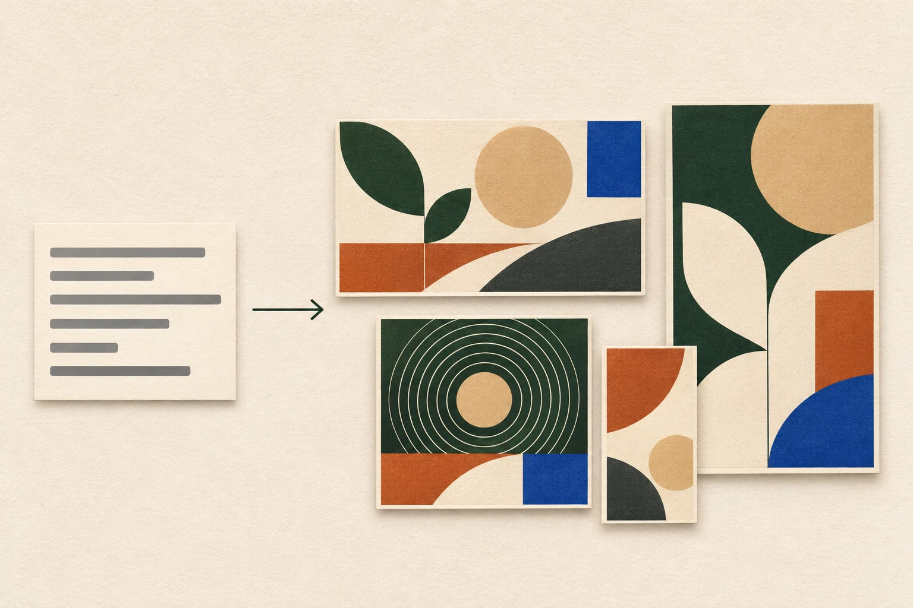
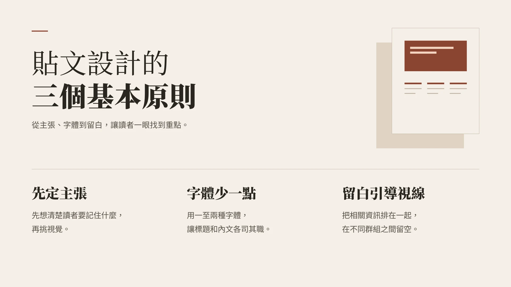
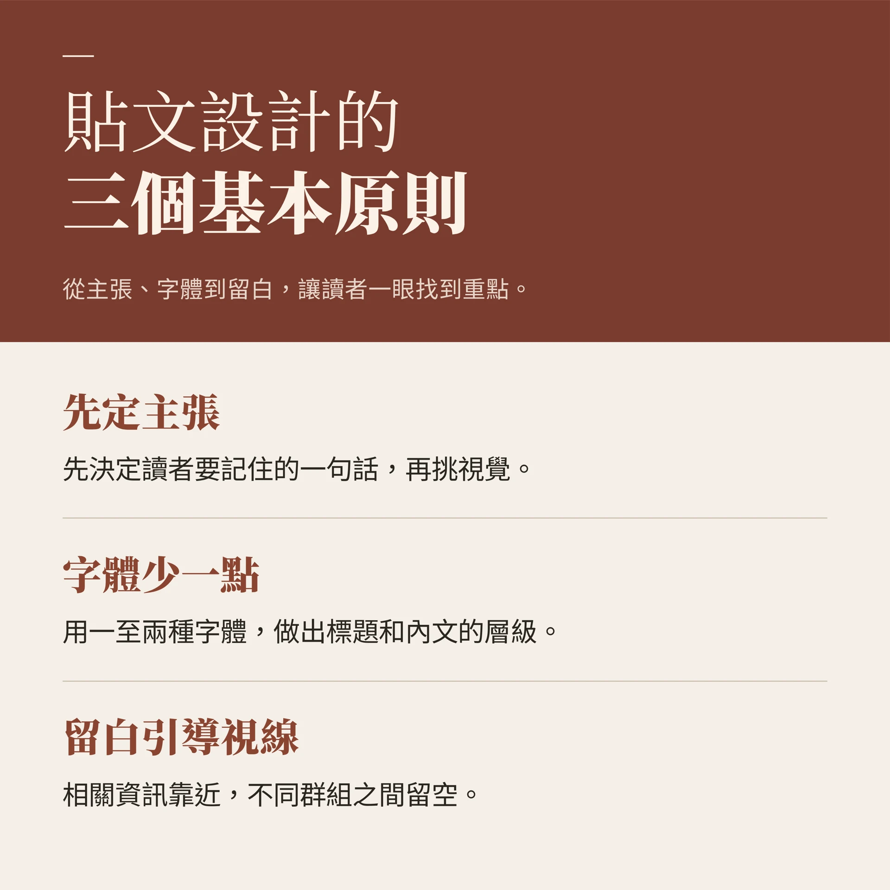
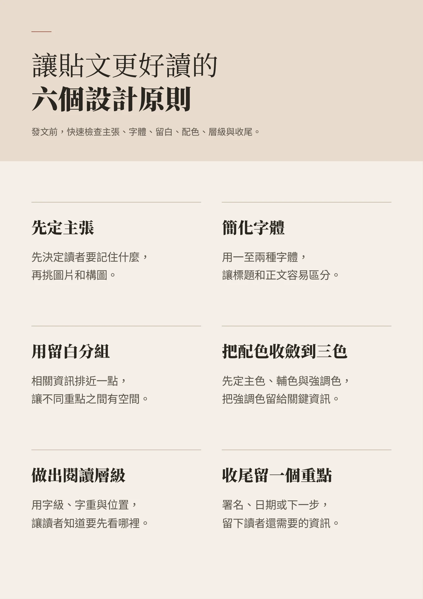
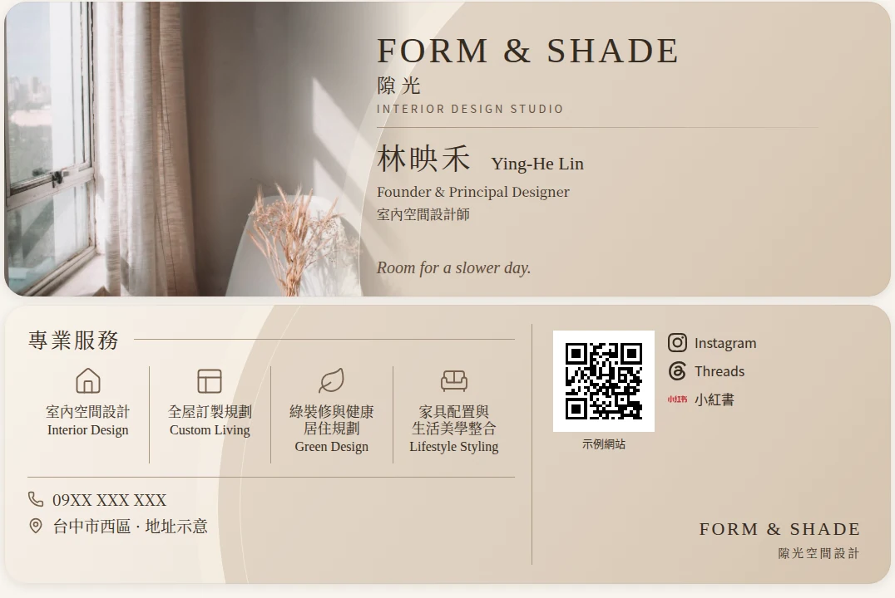

<div align="center">

# Concept Poster

給 AI 任意知識、內容，就可以直接輸出海報與單頁圖卡。

[](LICENSE)
[](SKILL.md)
[](#安裝與匯出)
[](#concept-poster-可以讓你輕鬆做出圖卡)

[如何使用](#如何使用這個-skills) · [範例](#範例) · [安裝與匯出](#安裝與匯出)



</div>

## Concept Poster 可以讓你輕鬆做出圖卡

文章、影片、筆記、一段想法都可以丟給它，它會幫你抓重點、排好版，直接變成一張能發的圖。

- **重點整理圖卡**：長文太長沒人看？幫你濃縮成三到六個重點，一張圖就講完。
- **流程圖、比較圖**：步驟、前後對比、兩種做法的差別，畫成圖比寫成字好懂很多。
- **概念海報**：有些觀念用圖講最快，例如用同心圓表示「以前做得到的」和「以前做不到的」。
- **雙面名片**：正面放照片、品牌和名字，背面放服務項目、聯絡方式、QR Code 和社群。

尺寸有三種可以選：

| 版型 | 適合用在 | 輸出尺寸 |
|------|----------|----------|
| 16:9 橫式（預設） | 簡報、YouTube 縮圖、部落格首圖 | 3840 × 2160 px |
| 1:1 方形 | IG、Threads、FB 貼文 | 3840 × 3840 px |
| A4 直式 | 列印、講義、長一點的清單 | 2715 × 3840 px |

想要別的尺寸也可以直接講。出圖之後還會留一份 HTML，想改字、改顏色隨時都能再改。

## 如何使用這個 Skills

步驟很簡單：

1. **把內容丟進來**：文字、影片連結、字幕、筆記、參考圖都可以。影片讀不到的話，補上影片檔或逐字稿就行。
2. **說你要做什麼**：海報還是名片、要哪個尺寸、拿去哪裡用。沒講的話預設做 16:9。
3. **看完再改**：第一版出來之後，哪裡不喜歡直接講，例如「標題再大一點」、「改成方形」、「最下面那行拿掉」。

### 範例 prompt

直接複製改一改就能用。

**整理一篇文章**

```text
用 concept-poster 把下面這篇文章整理成 IG 方形圖卡，抓三個重點就好，每個重點一句話講完。

（貼上文章）
```

**影片重點做成海報**

```text
用 concept-poster 看完這支影片，把裡面講的重點做成 A4 直式海報，六個重點排成兩欄，輸出 4K PNG。

https://www.youtube.com/watch?v=xxxx
```

**流程圖**

```text
用 concept-poster 畫一張 16:9 流程圖：收到需求 → 確認規格 → 做初稿 → 交付。
每一步放一個短標題和一句說明，要放進簡報投影也看得清楚。
```

**前後比較**

```text
用 concept-poster 做一張方形比較圖，左邊是「自己手動排版」，右邊是「交給 AI 排版」，
各列三個差別，讓人一眼看出差在哪。
```

**照參考圖的風格做**

```text
用 concept-poster 參考附件這張圖的配色和排版，幫我做一張「新手開店前要準備的五件事」16:9 海報。
參考圖只借風格，內容用我的。
```

**雙面名片**

```text
用 concept-poster 的暖米模板做雙面名片。
正面：王小明／室內設計師，放一張照片。
背面：四項服務、電話、地址、QR Code 連到 https://example.com，再加 IG 和 LINE。
```

**修改第一版**

```text
標題改成兩行，第二行再粗一點；整體改成 A4 直式，最下面的來源拿掉。
```

## 範例

### 16:9 橫式｜貼文設計的三個基本原則

> 用 `concept-poster` 做一張 16:9 海報，主題是貼文設計的三個基本原則：先定主張、字體少一點、留白引導視線。右上放一個版面示意圖。

[](assets/example-wide.webp)

### 1:1 方形｜同一個主題做成 IG 貼文

> 同樣的內容改成 IG 方形，標題放在上面的深紅色塊裡，三個重點往下排。

[](assets/example-square.webp)

### A4 直式｜讓貼文更好讀的六個設計原則

> 用 `concept-poster` 做 A4 直式海報，列出發文前要檢查的六件事：主張、字體、留白、配色、層級、收尾，排成兩欄。

[](assets/example-a4.webp)

### 雙面名片｜隙光空間設計

> 用暖米模板做一張雙面名片。正面放名字、職稱和照片，背面放四項服務、電話、地址、QR Code 和社群。參考圖只借風格，名字和聯絡方式用假資料。

[](assets/example-business-card.webp)

名片範例的照片來自 [Kelly Ritta／Pexels](https://www.pexels.com/photo/a-vase-of-dried-flowers-on-a-chair-by-the-window-4386224/)，圖示來自 [Lucide](https://lucide.dev/icons/) 和 [Simple Icons](https://simpleicons.org/)。QR Code 連到的是示範網站。

## 安裝與匯出

把整個 `concept-poster` 資料夾放進你的 Agent Skills 目錄就能用了。裡面的 `SKILL.md`、模板和參考文件位置不要亂動。

不想透過 AI，也可以直接用瀏覽器打開 `templates/` 裡的 HTML 自己改，再用下面的指令匯出 PNG：

```bash
python -m pip install -r requirements.txt
python -m playwright install chromium
python scripts/export_png.py templates/ppt-16x9.html poster.png
python scripts/export_png.py templates/ig-square-1x1.html square.png --preset square
python scripts/export_png.py templates/a4-portrait.html a4.png --preset a4
python scripts/export_png.py templates/business-card-warm.html card.png --preset card
```

幾個小提醒：

- 想改輸出大小，加 `--long-edge 2160` 這類參數調整長邊。
- 電腦裡已經有 Chromium 的話，可以用 `--chromium` 指定路徑。
- 中文變成一格一格的方框，代表少了字型，裝好 Noto Serif CJK TC 和 Noto Sans CJK TC 再匯出一次就好。

想深入了解可以看這幾份：

- [Skill 指令](SKILL.md)
- [海報排版指南](references/editorial-design.md)
- [雙面名片指南](references/business-card.md)

## 授權

程式和文件採用 [MIT 授權](LICENSE)。範例照片和第三方圖示照各自的授權與品牌規範使用，Lucide 的授權聲明放在 [這裡](assets/LICENSE-LUCIDE.txt)。
